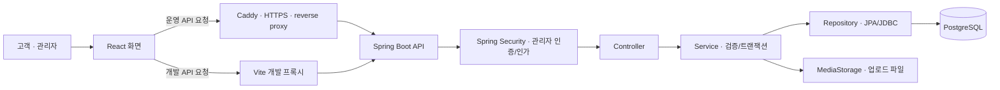
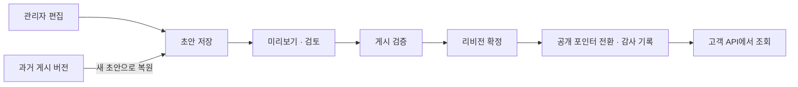
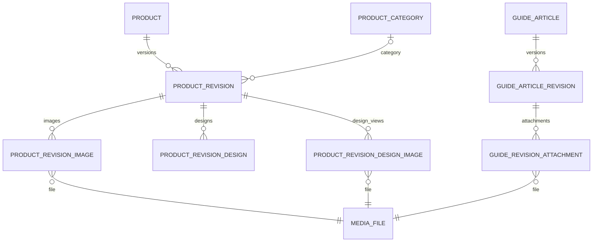
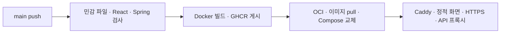

# NO.BLACK · HOME ARCADE

**게임처럼 탐색하는 침구 브랜드 웹사이트와 콘텐츠 관리 시스템(CMS)**

NO.BLACK의 블랙 침구를 오프닝, 퇴근길 게임, 나만의 방, 제품 카탈로그로 연결한 풀스택 프로젝트입니다. React로 브랜드 경험과 제품 미리보기를 구현하고, Spring Boot로 관리자 인증·콘텐츠 게시·파일 관리를 구성했습니다. 구매와 결제는 연결된 오늘의집 판매 페이지에서 진행합니다.

[서비스 주소](https://oooooo.kr) · [CI/CD](https://github.com/sksqlrlek/noblack/actions/workflows/ci-cd.yml)

서비스 주소는 저장소의 배포 설정 기준입니다. 아래 내용은 현재 소스와 설정을 기준으로 정리했습니다.

| 항목 | 내용 |
| --- | --- |
| 개발 기간 | 2026년 8월경 ~ 진행 중 (시작 월은 추정) |
| 개발 인원 | 1명 · AI 도구 활용 |
| 담당 범위 | 프론트엔드·백엔드·DB·배포 구성 |
| 협업 방식 | NO.BLACK 대표와 회의하며 요구사항과 수정 사항을 확인하고 반영 |

개발과 문서 정리에 AI 도구를 활용했습니다. 대표의 요청을 바탕으로 기능과 화면을 구현하고, 회의에서 나온 피드백을 반영하며 진행하는 프로젝트입니다.

## 1. 프로젝트 목표

- 브랜드의 취향을 게임과 방 탐색으로 경험하고, 관심 있는 제품의 정보와 디자인을 확인하는 흐름을 만듭니다.
- 운영자가 코드를 수정하지 않고 제품·이미지·안내를 편집하고 게시할 수 있게 합니다.
- 초안이 고객에게 노출되거나 다른 관리자의 수정 내용을 덮어쓰는 상황을 방지합니다.
- 프론트엔드 화면 구현부터 API·DB·인증·자동화 검사·배포 구성까지 연결합니다.

## 2. 주요 기능

| 구분 | 경로 | 구현 내용 |
| --- | --- | --- |
| HOME | `/` | 숫자·로고 오프닝, Canvas 기반 횡스크롤 퇴근길 게임, 이동·점프·일시정지 |
| MY ROOM | `/room` | 캐릭터 이동, 화면 크기에 따른 카메라·확대, 휴식·즐거움·취향 퀘스트 |
| ITEMS | `/item-book` | 카테고리·검색·정렬·페이지 이동, 제품 목록·상세, 관련 제품과 판매 링크 |
| 제품 미리보기 | `/item-book?product=slick-duvet` 등 | 게임·실제·사용 이미지 전환, 디자인 선택, 이름·글꼴 레터링 미리보기 |
| THE BRAND | `/archive` | 브랜드 소개·이미지·영상 |
| GUIDE | `/guide` | 공지·사용설명서·관리 안내·주문/배송/교환 QNA, 검색과 본문 읽기 |
| 이용·운영 정보 | `/site-guide`, `/system`, `/system/company`, `/system/privacy` | 사이트 조작법, 사업자 정보, 개인정보 안내 |
| 관리자 | `/admin` | 로그인, 제품·카테고리·안내 편집, 미리보기·게시·이력·파일 관리 |

PC에서는 키보드·조이스틱·A/B 버튼을, 모바일에서는 터치·스와이프와 화면 조작부를 지원합니다. 건너뛰기 링크, 포커스 복귀, 화면별 HELP, 동작 줄이기 설정도 고려했습니다.

제품의 분류·페이지·선택 상태는 URL과 탐색 상태에 연결해 상세 화면에서 목록으로 돌아올 때 복원합니다. 방의 완료 퀘스트는 **현재 탭의 `sessionStorage`**, 사운드 설정은 `localStorage`에 저장합니다. 퀘스트 상태는 같은 탭의 새로고침 후에도 유지되며, 새 탭은 새 진행 상태로 시작합니다.

`/item/:productId`, `/decor`, `/black-room` 등 이전 주소는 현재 경로로 연결합니다. 제품과 안내의 내용·개수는 DB 게시 데이터에 따라 달라집니다.

## 3. 기술 스택

| 영역 | 기술 | 사용 목적 |
| --- | --- | --- |
| Frontend | React 19, TypeScript 7, React Router 7 | 화면 조합, 타입 검사, URL 기반 탐색 |
| 개발·빌드 | Vite 8, Node.js | 개발 서버, API 프록시, 정적 파일 번들링 |
| 게임·사운드 | Canvas API, Web Audio API | 퇴근길 게임 렌더링, 효과음 |
| Backend | Java 21, Spring Boot 4.1.1, Maven | REST API, 애플리케이션 구성·빌드 |
| 인증·검증 | Spring Security, Bean Validation, Argon2id | 세션 인증, 관리자 권한·요청·비밀번호 검증 |
| 데이터 접근 | Spring Data JPA, Spring JDBC | 관리자·클릭 기록과 CMS 데이터 처리 |
| Database | PostgreSQL 18, Flyway | 콘텐츠·이력 저장, V1~V9 스키마 변경 관리 |
| 테스트 | Playwright, JUnit, Spring Boot Test, MockMvc | 브라우저 동작, 단위·DB 통합 검사 |
| 배포 | Docker Compose, Caddy, GitHub Actions, GHCR, OCI | 컨테이너 실행, HTTPS·프록시, 검사·이미지 게시·배포 |
| 개발 도구 | VS Code / Eclipse(eGov 개발 환경) | 프론트엔드 / 백엔드 개발 |

프론트엔드의 정확한 버전은 [package.json](frontend/package.json), 백엔드는 [pom.xml](backend/pom.xml)을 기준으로 합니다. 백엔드는 Spring Boot 프로젝트이며 eGovFrame 런타임 의존성은 사용하지 않습니다.

## 4. 전체 구조



Caddy는 빌드된 React 파일도 제공합니다. 공개 API는 게시된 콘텐츠를 조회하며, 관리자 API의 접근 권한과 변경 요청은 서버에서 검사합니다.

프론트엔드는 **화면 조립 → 상태·조작 훅 → API 읽기·응답 변환 → 표시 컴포넌트**로 역할을 나눴습니다. `ArcadePage`가 공통 프레임을 구성하고, `useArcadeController`가 입력과 포커스를 연결합니다. `publicContent.ts`는 서버 응답을 검사해 화면에서 사용하는 타입으로 변환합니다.

백엔드는 **Controller → Service → Repository** 계층과 생성자 주입을 사용합니다. Controller는 HTTP 입출력, Service는 업무 규칙과 트랜잭션, Repository는 DB 접근을 담당합니다.

```text
noblack/
├─ frontend/
│  ├─ src/
│  │  ├─ pages/               # 아케이드 화면·모바일 제품 화면
│  │  ├─ components/          # 공통 프레임·제품 미리보기·안내
│  │  ├─ hooks/               # 조작·포커스·API 상태·반응형 훅
│  │  ├─ services/            # 공개 API 응답 검사·변환
│  │  ├─ admin/               # 관리자 인증·편집·게시·파일함
│  │  ├─ noblack-content/     # 게임·방·제품·안내 콘텐츠
│  │  │  └─ core/             # 이동·카메라 등 화면 밖의 계산 로직
│  │  ├─ data/                # 공통 타입·메뉴·제품 표시 규칙
│  │  └─ assets/, styles/     # 고정 미디어·글꼴·스타일
│  └─ tests/                  # Playwright 시나리오와 대체 API
├─ backend/
│  ├─ src/main/java/kr/co/noblack/backend/
│  │  ├─ admin/               # 관리자 인증·계정·CLI
│  │  ├─ cms/                 # 제품·카테고리·안내 CMS
│  │  ├─ media/               # 파일 검증·저장·참조 관리
│  │  ├─ outbound/            # 판매 링크 이동·클릭 기록
│  │  └─ common/, config/     # 공통 응답·감사 이력·설정
│  ├─ src/main/resources/db/migration/
│  ├─ src/test/               # 단위·DB·보안·통합 검사
│  ├─ scripts/                # 계정 생성·콘텐츠 이관·격리 DB 검사
│  └─ content/                # 초기 제품 이관 명세와 이미지
├─ deploy/                    # 운영 DB 계정 준비·최초 콘텐츠 이관
├─ .github/workflows/ci-cd.yml
├─ docker-compose.yml         # 로컬 DB·백엔드·프론트엔드
└─ docker-compose.prod.yml    # 운영 컨테이너 구성
```

## 5. 핵심 설계

### 초안과 게시본을 분리한 CMS

제품을 저장할 때마다 고객 화면이 즉시 바뀌면 작성 중인 문구나 미완성 이미지가 노출될 수 있습니다. 제품의 식별 정보와 버전별 본문을 분리하고, 고객은 `published_revision_id`가 가리키는 게시본만 읽도록 구성했습니다.



게시 검증·리비전 확정·공개 포인터 변경·감사 기록은 하나의 트랜잭션에서 처리합니다. 확정된 본문과 파일 연결은 DB 트리거로 직접 변경을 제한합니다. 숨김·휴지통은 공개 조회를 중단하고, 복구한 콘텐츠는 다시 검토할 수 있도록 숨김 상태 또는 새 초안으로 처리합니다.

관리자가 읽은 `expectedVersion`과 현재 버전이 다르면 **409 Conflict**를 반환합니다. 수정 시 행 잠금과 버전 조건을 함께 사용해 오래된 편집 내용이 최신 내용을 덮어쓰지 않게 합니다.

구현: [ContentService](backend/src/main/java/kr/co/noblack/backend/cms/service/ContentService.java), [ContentRepository](backend/src/main/java/kr/co/noblack/backend/cms/repository/ContentRepository.java)

### 데이터 구조



- `product`, `guide_article`: 고유 코드·상태·공개 리비전 ID·동시 수정 버전·삭제 시점을 관리합니다.
- `product_revision`, `guide_article_revision`: 제목·분류·검색 정보·JSONB 본문을 버전별로 저장합니다. JSONB는 구조화된 JSON을 DB에 저장하는 형식입니다.
- `media_file`과 참조 테이블: 이미지·디자인·첨부파일의 사용 위치를 버전에 연결합니다.
- `admin_user`, `admin_audit_log`, `outbound_click`: 관리자 계정, 변경 감사 이력, 판매 링크 API의 클릭 기록을 저장합니다.

제품마다 테이블이나 상세 화면을 추가하지 않고 소개·특징·사이즈·기본 정보의 공통 구조를 사용합니다. 사이즈는 `SINGLE`, `MULTIPLE`, `SET`, `HIDDEN`으로 표현합니다. 정보가 확인되지 않은 항목은 추정해서 채우지 않으며, 가격·배송·교환/반품의 상세 조건은 판매 페이지에서 확인하도록 안내합니다.

전체 제약·인덱스·보호 트리거는 [Flyway 마이그레이션](backend/src/main/resources/db/migration)에 있습니다.

### 관리자 인증과 파일 관리

| 항목 | 구현 내용 |
| --- | --- |
| 인증 방식 | Spring Security 세션 인증, `/api/admin/**`의 `ADMIN` 권한 검사 |
| 비밀번호 | Argon2id 해시, 길이·입력 검증, 기본 관리자 비밀번호 미제공 |
| 로그인 보호 | 출처별 요청 제한, 연속 실패 잠금, 로그인 시 세션 ID 교체 |
| 세션·CSRF | 유휴 30분, 계정 상태·보안 버전 재검사, 변경 요청에 CSRF 토큰 적용 |
| 쿠키 | HttpOnly·SameSite=Lax·Secure 기본값, 로컬 HTTP 개발용 `dev` 프로필 |
| 파일 업로드 | 실제 파일 형식·크기·이미지/PDF/글꼴 구조 검사, 무작위 저장 키 |
| 파일 공개·삭제 | 게시본의 파일 참조 확인, 초안·게시본 사용 파일 삭제 차단, 과거 버전 사용 경고 |
| 운영 DB | 마이그레이션 계정과 제한된 런타임 계정 분리 |

관리자 파일함은 업로드·검색·종류 필터·페이지 이동·파일명 변경·다중 선택 삭제를 지원합니다. 다중 삭제는 최신 사용 상태를 확인한 후 파일별로 순차 처리하며, 성공·제외·실패·미처리 결과를 구분합니다. 네트워크 오류가 발생한 변경 요청은 자동으로 재전송하지 않아 중복 처리를 줄입니다.

### 디자인 패턴 검토

| 패턴 | 적용·검토 내용 |
| --- | --- |
| 싱글톤 | Spring Bean의 기본 singleton scope로 서비스·저장소 객체를 관리합니다. 프론트엔드 사운드는 React Context와 생명주기로 공유합니다. 직접 만든 전역 singleton 클래스는 없습니다. |
| 브리지 | 키보드·조이스틱 입력과 화면별 동작을 `SceneController` 인터페이스와 React ref로 연결합니다. 구현체와 조작부를 분리한 설계이며, GoF 클래스 구조를 그대로 구현한 것은 아닙니다. |
| 팩토리 메서드 | 현재 객체 생성은 Spring DI와 명시적 생성으로 충분해 상속 기반 Factory Method 계층은 도입하지 않았습니다. |
| 템플릿 메서드 | 제품·안내의 게시 순서는 `ContentService.publish`에서 공유합니다. 상속으로 단계를 교체하는 GoF Template Method는 도입하지 않았습니다. |

파일 저장은 `MediaStorage` 인터페이스와 `LocalMediaStorage` 구현을 분리했습니다. 다른 저장소가 필요할 때 업무 서비스의 파일 저장 의존성을 교체할 수 있지만, 현재 실제 구현은 로컬 파일 저장소입니다.

## 6. 문제 해결 사례

| 문제 | 원인과 해결 | 확인 코드·테스트 |
| --- | --- | --- |
| 느린 화면 전환 후 포커스가 이동함 | 예약된 메뉴 포커스 복원이 사용자의 새 선택을 덮어썼습니다. 진입 시 포커스를 기록하고, 복원 직전에 현재 포커스와 비교합니다. | [useArcadeController](frontend/src/hooks/useArcadeController.ts), [catalog-entry.spec.ts](frontend/tests/catalog-entry.spec.ts) |
| 방의 퀘스트 표시가 화면마다 어긋남 | 숨긴 설명의 너비와 버튼 중심 정렬이 사물 좌표에 영향을 줬습니다. 원본 이미지의 비율 좌표·꼬리 끝 기준·상자 높이를 분리했습니다. | [room.ts](frontend/src/noblack-content/core/room.ts), [room-markers.spec.ts](frontend/tests/room-markers.spec.ts) |
| 개발 중 `504 Outdated Optimize Dep` 발생 | 개발 서버와 프록시 검증 서버가 의존성 캐시를 공유했습니다. 앱은 모드·API 대상별로, 테스트는 실행별로 캐시를 분리했습니다. | [vite.config.ts](frontend/vite.config.ts), [dev-api-proxy.spec.ts](frontend/tests/dev-api-proxy.spec.ts) |
| 이전 API 응답이 현재 화면을 덮어쓸 수 있음 | 분류·페이지를 바꾼 뒤 늦게 완료된 요청이 남을 수 있습니다. `AbortController`와 요청 키로 이전 결과를 버리고 로딩·빈 목록·오류를 구분합니다. | [usePublicContent](frontend/src/hooks/usePublicContent.ts), [public-content.spec.ts](frontend/tests/public-content.spec.ts) |

## 7. 로컬 실행

명령은 Windows PowerShell 기준입니다. 프론트엔드 개발에는 Node.js `^22.13.0` 또는 `>=24.0.0`이 필요하며 CI는 24를 사용합니다. 백엔드를 IDE에서 실행하려면 JDK 21과 Maven이 필요합니다. DB와 컨테이너 실행에는 Docker Compose를 사용합니다.

### Docker로 전체 실행

저장소 루트에 `.env`를 만들고 로컬 DB 값을 지정합니다. 아래 비밀번호는 직접 정한 값으로 바꿉니다.

```dotenv
POSTGRES_DB=noblack
POSTGRES_USER=noblack_app
POSTGRES_PASSWORD=직접_정한_로컬_DB_비밀번호
```

루트 터미널에서 실행합니다.

```powershell
docker compose up -d --build
```

고객 화면은 `http://localhost:3000`, 관리자는 `http://localhost:3000/admin`입니다. DB는 로컬 `5433`, 백엔드는 `8080`에 연결됩니다.

### VS Code에서 프론트엔드 개발

루트에서 DB·백엔드를 실행한 뒤 `frontend` 폴더의 개발 서버를 사용합니다.

```powershell
docker compose up -d --build postgres backend
cd frontend
npm.cmd ci
npm.cmd run dev
```

접속 주소는 `http://127.0.0.1:5173`입니다. 관리자도 같은 주소의 `/admin`을 사용합니다. 프론트 파일은 저장 후 바로 반영되며, 백엔드 코드를 바꿨을 때는 해당 이미지를 다시 빌드합니다.

`frontend/.env.example`을 참고해 `.env.local`의 API 대상을 확인합니다. 로컬 백엔드를 사용하는 값은 다음과 같습니다.

```dotenv
VITE_API_PROXY_TARGET=http://localhost:8080
VITE_API_READ_ONLY=false
```

API 대상을 원격 서버로 지정하면 관리자 저장·게시·업로드도 그 서버에 반영됩니다. 게시 데이터만 조회하려면 `VITE_API_READ_ONLY=true`를 사용합니다. 이 모드는 관리자·변경 요청을 차단합니다. 설정을 바꾸면 Vite를 재시작합니다. `VITE_` 변수에는 비밀값을 넣지 않습니다.

### Eclipse에서 백엔드 개발

1. 루트에서 `docker compose up -d postgres`로 DB를 실행합니다. Docker 백엔드가 실행 중이면 먼저 `docker compose stop backend`로 중지해 8080 포트 충돌을 피합니다.
2. Eclipse의 **Existing Maven Projects**로 `backend`를 가져오고 JDK 21을 지정합니다.
3. 실행 환경 변수에 아래 값을 등록합니다. DB 계정·비밀번호는 루트 `.env`와 맞추고, 작업 디렉터리는 `backend`로 지정합니다.
4. `NoblackBackendApplication`을 실행합니다. 프론트엔드는 VS Code의 Vite 개발 서버를 사용합니다.

```dotenv
DB_URL=jdbc:postgresql://localhost:5433/noblack
DB_USERNAME=noblack_app
DB_PASSWORD=직접_정한_로컬_DB_비밀번호
SPRING_PROFILES_ACTIVE=dev
UPLOAD_DIRECTORY=./var/uploads
```

Spring Boot는 `.env` 파일을 자동으로 읽지 않습니다. 위 환경 변수가 설정된 터미널에서는 `backend` 폴더에서 `mvn spring-boot:run`으로도 실행할 수 있습니다.

### 최초 관리자와 콘텐츠

기본 관리자 계정은 자동 생성하지 않습니다. 로컬 Docker 백엔드를 실행한 상태에서 루트의 **대화식 터미널**로 다음 명령을 실행하면 아이디·표시 이름·비밀번호를 입력할 수 있습니다.

```powershell
powershell.exe -NoProfile -ExecutionPolicy Bypass -File .\backend\scripts\New-LocalAdmin.ps1
```

Eclipse 방식에서는 백엔드를 패키징한 후 같은 DB·프로필 환경 변수가 설정된 `backend` 터미널에서 CLI를 실행할 수 있습니다.

```powershell
mvn -B package
java -jar target/noblack-backend-0.0.1-SNAPSHOT.jar --admin.command=create --admin.login=localadmin --admin.name=LocalAdmin
```

비밀번호는 실행 중 터미널에서 두 번 입력하며 명령 인자로 전달하지 않습니다. 최초 계정 이후 관리자 추가는 CLI의 `--admin.command=add`를 사용합니다.

새 DB에는 사이트의 전체 제품 이미지·본문이 자동 등록되지 않습니다. 관리자에서 등록하거나 아래 초기 이관을 실행합니다. V9는 기본 QNA 일부를 별도로 생성합니다.

<details>
<summary>초기 콘텐츠 이관 방법</summary>

루트에서 기존 정적 데이터를 이관 명세로 변환합니다.

```powershell
node backend/scripts/Export-LegacyContent.mjs
```

`backend` 폴더에서 `mvn -B package`를 완료하고 DB·업로드 경로·프로필 환경 변수를 설정한 뒤 실행합니다.

```powershell
java -jar target/noblack-backend-0.0.1-SNAPSHOT.jar --admin.command=import --admin.import=target/legacy-content.json --admin.publish-products=true
java -jar target/noblack-backend-0.0.1-SNAPSHOT.jar --admin.command=import --admin.import=content/monochrome-pillow/manifest.json --admin.publish-products=true
java -jar target/noblack-backend-0.0.1-SNAPSHOT.jar --admin.command=import --admin.import=content/sports-pillow/manifest.json --admin.publish-products=true
```

같은 제품 코드는 건너뛰므로 반복 실행으로 기존 제품을 갱신하지 않습니다. 이관 이후 문구·사진·판매 링크는 관리자에서 편집·게시합니다. `src/data`의 정적 제품 배열은 초기 이관과 테스트에 사용하며 고객 화면의 게시 데이터를 대신하지 않습니다.

</details>

## 8. 주요 API

| 구분 | 메서드·경로 | 역할 |
| --- | --- | --- |
| 제품 | `GET /api/products`, `GET /api/products/{code}` | 게시 제품 목록·단건 조회 |
| 카테고리 | `GET /api/product-categories` | 게시 제품의 분류 조회 |
| 안내 | `GET /api/guides`, `GET /api/guides/{type}/{code}` | 공지·설명서·관리 안내·QNA 조회 |
| 안내 분류 | `GET /api/guide-categories` | 분류별 게시 글 수 조회 |
| 파일 | `GET /api/media/{id}/content`, `GET /api/media/{id}/download` | 공개 가능한 파일 조회·다운로드 |
| 관리자 인증 | `/api/admin/csrf`, `/api/admin/login`, `/api/admin/me`, `/api/admin/logout` | CSRF·로그인·세션 확인·로그아웃 |
| 관리자 콘텐츠 | `/api/admin/products/**`, `/api/admin/guides/**`, `/api/admin/product-categories/**` | 초안·게시·순서·상태·이력 관리 |
| 관리자 파일 | `/api/admin/media/**` | 업로드·사용 위치·이름·삭제 관리 |
| 판매 링크 이동 | `GET /api/outbound/product/{code}?source=item-detail` | 게시 판매 URL 검증, 클릭 기록 후 HTTP 302 이동 |

목록 API는 `page`, `size`, 검색어 `q` 등을 사용합니다. 제품 목록은 `category`, 안내 목록은 `type`, `productCode` 조건도 지원합니다. 상세 계약은 [공개 Controller](backend/src/main/java/kr/co/noblack/backend/cms/controller/PublicContentController.java)와 [DTO](backend/src/main/java/kr/co/noblack/backend/cms/dto/ContentDtos.java)를 기준으로 합니다.

현재 고객 제품 화면은 판매 URL로 직접 이동합니다. 클릭 기록은 outbound API를 호출한 경우에만 남으므로, 모든 구매 버튼 클릭을 집계하는 구조는 아닙니다. outbound API는 클릭 저장 중 DB 오류가 나도 유효한 판매 URL로의 이동을 계속합니다.

## 9. 테스트와 검증 범위

| 구분 | 검사 대상 |
| --- | --- |
| 프론트엔드 정적 검사 | TypeScript strict 타입 검사, Vite 프로덕션 빌드 |
| Playwright | 게임·방·메뉴 조작, URL·포커스 복귀, PC/모바일 배치, 디자인·레터링, 관리자 편집·게시·오류·파일 관리 |
| 백엔드 단위 검사 | 계정·비밀번호 정책, 판매 URL 정책, 파일 검증 등 |
| DB 통합 검사 | 실제 PostgreSQL 제약·트랜잭션, 인증·CSRF·세션, CMS 게시·동시 수정, 파일 참조, 운영 DB 권한 |
| CI | 민감 파일 추적 검사, 프론트·백엔드 검사, 런타임 npm 의존성 취약점 검사 |

프론트엔드 폴더에서 실행합니다. `test:e2e`는 빌드 후 미리보기 서버와 브라우저 검사를 실행합니다.

```powershell
cd frontend
npm.cmd ci
npm.cmd run typecheck
npx.cmd playwright install chromium
npm.cmd run test:e2e
```

설치된 Chrome을 쓰려면 `$env:PLAYWRIGHT_CHANNEL = 'chrome'`을 설정합니다. 방 표시의 브라우저별 검사는 [playwright.room.config.ts](frontend/playwright.room.config.ts)에 Chrome·Edge·Firefox·WebKit으로 구성되어 있으며, 해당 브라우저를 준비한 뒤 `npm.cmd run test:room-markers`로 실행합니다.

백엔드 폴더에서 실행합니다.

```powershell
cd backend
mvn -B clean verify
```

전용 DB 환경 변수가 없으면 일부 DB 통합 테스트는 건너뜁니다. 로컬에 PostgreSQL 18 실행 파일·JDK·Maven이 준비되어 있다면 루트에서 격리 DB 도구로 전체 백엔드 검증을 실행할 수 있습니다. PostgreSQL 설치 경로가 다르면 `-PostgresBin`으로 지정합니다.

```powershell
powershell.exe -NoProfile -ExecutionPolicy Bypass -File .\backend\scripts\Test-AdminUserSchema.ps1 -RunBackendTests
```

브라우저 테스트는 대체 API 응답을 주로 사용하고, 개발 프록시 검사는 로컬 대체 백엔드를 연결합니다. 백엔드 통합 검사는 별도 테스트 DB를 사용합니다. 이 결과만으로 운영 데이터·외부 주문/결제·실제 모바일 기기·서버 부하 검증까지 완료했다고 볼 수는 없습니다. 실제 실행 결과는 [GitHub Actions](https://github.com/sksqlrlek/noblack/actions)에서 확인할 수 있습니다.

## 10. 배포와 운영

일반 PR과 `main`, `feature/**`, `deploy/**` push에서 검사를 실행합니다. **`main` push의 검사 통과 후** 프론트·백엔드 이미지를 커밋 SHA와 `latest` 태그로 GHCR에 게시하고 OCI 서버의 Compose 컨테이너를 교체합니다.



운영은 [docker-compose.prod.yml](docker-compose.prod.yml)을 사용하며 DB와 백엔드는 외부 포트를 공개하지 않습니다. Caddy가 웹 포트와 TLS를 담당하고, DB·업로드·인증서 데이터는 Docker named volume에 저장합니다. OCI의 1GB 메모리 환경을 고려한 컨테이너·JVM·DB 메모리 설정도 포함되어 있습니다.

<details>
<summary>운영 설정과 최초 콘텐츠 작업</summary>

- GitHub `production` 환경의 Secrets: `OCI_HOST`, `OCI_USER`, `OCI_SSH_PRIVATE_KEY`, `GHCR_READ_TOKEN`.
- 서버 `/home/<OCI_USER>/noblack/.env`: `POSTGRES_DB`, `POSTGRES_USER`, `POSTGRES_PASSWORD`, `DB_USERNAME`, `DB_PASSWORD`, `DOMAIN`, `WWW_DOMAIN`.
- `POSTGRES_*`의 DB 소유자 계정은 마이그레이션에, `DB_USERNAME`·`DB_PASSWORD`의 제한 계정은 웹 런타임에 사용합니다.
- [prepare-runtime-db.sh](deploy/prepare-runtime-db.sh)가 제한 DB 계정을 준비합니다. 동작을 바꿀 때는 [전용 검사](deploy/tests/prepare-runtime-db.test.sh)도 확인합니다.
- 도메인 DNS는 운영 서버를 가리켜야 하며 서버에서 Docker와 GHCR 이미지 접근을 준비해야 합니다. CI는 서버에서 소스를 빌드하지 않습니다.
- Actions 수동 실행의 `initialize_content`를 켜면 최초 콘텐츠 작업을 선택할 수 있습니다. `content_action=inspect`는 읽기 전용 점검, `import`는 백업 후 없는 제품을 이관합니다.
- 이관 목록은 슬릭 5종·모노크롬 3종·스포츠 6종입니다. 기존 코드의 제품은 덮어쓰지 않으며 현재 게시 제품 수를 뜻하지 않습니다.
- 코드 배포, DB 스키마 마이그레이션, 최초 제품 이관은 서로 다른 작업입니다. 운영 데이터 변경은 관리자 또는 해당 이관 절차를 사용합니다.

DB와 업로드 파일은 함께 백업해야 복구할 수 있습니다. `docker compose down -v`는 named volume을 삭제하므로 데이터 보존이 필요한 환경에서 실행하지 않습니다. `.env`, 계정 비밀번호, SSH 키, DB 덤프와 업로드 백업은 Git에 넣지 않습니다.

</details>

## 11. 현재 한계와 개선 과제

- 세션과 로그인 출처별 요청 제한은 단일 백엔드 인스턴스를 기준으로 합니다. 다중 인스턴스로 확장하려면 공유 저장소 설계가 필요합니다.
- 업로드 파일은 로컬 볼륨에 저장합니다. 저장 용량·백업·복구 요구가 커지면 `MediaStorage`를 통한 외부 저장소 연결을 검토할 수 있습니다.
- 모바일 카탈로그는 소규모 제품 구성을 전제로 게시 목록을 모아 정렬·필터링합니다. 제품이 많아지면 서버 검색·정렬·페이지 처리로 전환할 필요가 있습니다.
- 서버 부하와 장애 복구, 실제 모바일 기기 검사는 별도의 검증과 기록이 필요합니다.

## 12. 라이선스와 콘텐츠

이미지·영상·브랜드 콘텐츠의 이용 범위는 각 권리와 제공 조건을 확인해야 합니다. 번들 글꼴의 라이선스 고지는 [프론트 Galmuri OFL](frontend/src/assets/Galmuri-OFL.md), [백엔드 Galmuri OFL](backend/src/main/resources/fonts/Galmuri-OFL.md), [기타 공개 글꼴 라이선스](frontend/public/licenses)에 보관합니다.
